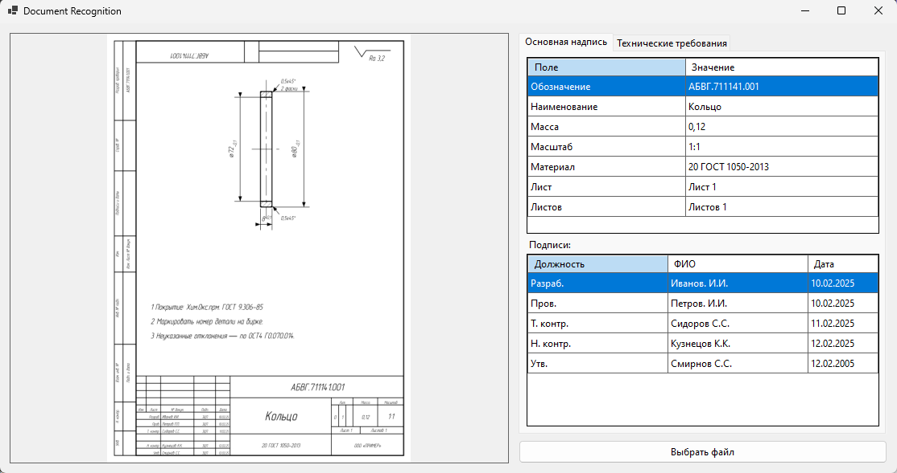
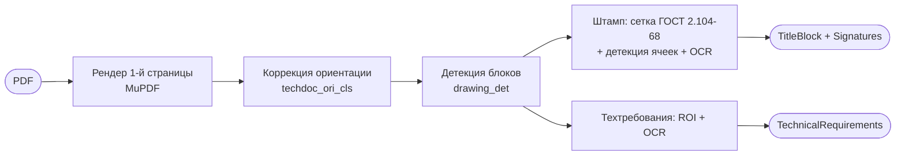
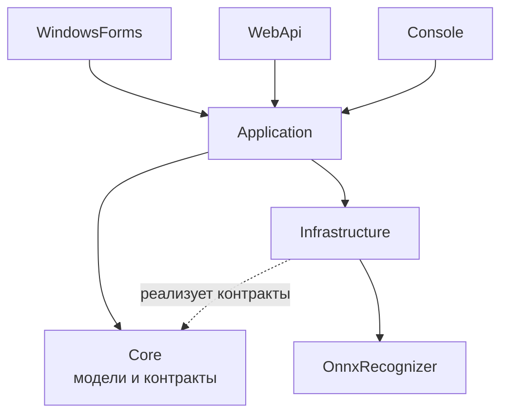

# DocumentRecognition

Распознавание чертежей: извлечение **основной надписи (штамп по ГОСТ 2.104-68)** и **технических требований** из PDF-файла.

Проект вырос из пет-проекта и сейчас сфокусирован на одном сценарии — чертежи. В коде оставлены точки расширения под другие виды документов, но они не влияют на текущую работу.


---


## Возможности

- **Вход**: PDF-файл с чертежом (обрабатывается первая страница).
- **Коррекция ориентации** страницы и текстовых строк — чертёж может быть отсканирован повёрнутым.
- **Детекция блоков чертежа** нейросетью: штамп (`title_block_2`), технические требования (`technical_requirements`), таблицы (`configuration_table`, `parameter_table`), дополнительные графики.
- **Основная надпись**: обозначение, наименование, масса, масштаб, материал, номер листа, число листов.
- **Подписи**: должность (распознанный текст + нормализованный идентификатор), ФИО, дата.
- **Технические требования**: список пунктов в порядке следования.
- **Отладочное изображение** с найденными блоками (полезно при разборе ошибок).
- Три интерфейса к одному ядру:
  - **WindowsForms** — просмотр результата на двух вкладках, данные в таблицах;
  - **WebApi** — REST-эндпоинт, ответ в JSON, Swagger UI;
  - **Console** — человекочитаемый вывод или JSON для скриптов/интеграций.
- Единый DTO результата (`DrawingRecognitionResultDto`), одинаковый для API и CLI.

## Как это работает



Кратко по шагам:

1. PDF конвертируется в изображение.
2. Модель ориентации разворачивает страницу в правильное положение.
3. Layout-детектор находит блоки чертежа.
4. Для штампа строится эталонная сетка по ГОСТ 2.104-68, сопоставляется с найденными ячейками таблицы, содержимое ячеек распознаётся OCR.
5. Блоки технических требований распознаются построчно с учётом ориентации строк.
6. Результат собирается в `DrawingRecognitionResult`: штамп, подписи, список техтребований, отладочное изображение.

## Архитектура

| Проект | TargetFramework | Назначение |
|---|---|---|
| `DocumentRecognition.Core` | `netstandard2.0;net8.0;net48` | доменные модели (`TitleBlock`, `Signature`, результаты), интерфейсы (`IRecognizer`, `IPdfDocument`), enum'ы |
| `DocumentRecognition.Application` | `netstandard2.0;net8.0;net48` | оркестрация (`DocumentRecognitionService`), DTO результата |
| `DocumentRecognition.Infrastructure` | `netstandard2.0;net8.0;net48` | обёртка MuPDF, пайплайн распознавания, шаблон штампа ГОСТ 2.104-68, DI-регистрация |
| `DocumentRecognition.OnnxRecognizer` | `netstandard2.0;net8.0;net48` | ONNX-инференс: OCR-движок (форк RapidOCRCSharp), детекторы layout/ориентации/ячеек |
| `DocumentRecognition.WindowsForms` | `net8.0-windows` | desktop UI |
| `DocumentRecognition.WebApi` | `net8.0` | REST API + Swagger |
| `DocumentRecognition.Console` | `net8.0` | CLI |



Библиотечные проекты мультитаргетные: `net8.0` — для приложений решения, `netstandard2.0`/`net48` — задел на переиспользование в .NET Framework-проектах.

## Требования окружения

| Требование | Детали |
|---|---|
| .NET SDK | 8.0.x |
| ОС | **Windows 10/11 x64** — WinForms и нативные зависимости (`OpenCvSharp4.runtime.win`, DirectML) работают только на Windows |
| GPU | **не обязателен**: DirectML используется автоматически, при недоступности — автоматический откат на CPU |
| ОЗУ | от 8 ГБ (несколько ONNX-моделей в памяти) |
| Диск | ≈ 0.4 ГБ под модели + NuGet-кеш |
| Сборка `net48`-таргетов библиотек | нужен .NET Framework 4.8 Targeting Pack (входит в Visual Studio 2022). Для CI на Linux — пакет `Microsoft.NETFramework.ReferenceAssemblies` либо сборка только `net8.0` |
| Модели | **не хранятся в репозитории** (см. `.gitignore`), скачиваются скриптом `scripts/Get-OnnxModels.ps1` |

## ONNX-модели

Файлы нужно положить в `src/Shared/OnnxModels`. Проекты с `IncludeModels=true` (WinForms, WebApi, Console) копируют их в выходной каталог в подпапку `OnnxModels` (см. `src/Directory.Build.props`).

Все модели получены с помощью инструментов **PaddlePaddle**: часть используется «из коробки», часть дообучена (fine-tune) под чертежи и ГОСТ-шрифт.

| Файл | Размер | Происхождение | Назначение |
|---|---|---|---|
| `drawing_det_v4.onnx` | ~123 МБ | PaddleDetection, **fine-tune** под чертежи | детекция блоков чертежа |
| `RT-DETR-L_wired_table_cell_det.onnx` | ~123 МБ | RT-DETR (PaddleDetection), **fine-tune** под ячейки таблиц | детекция ячеек таблицы штампа |
| `ch_PP-OCRv5_det_server.onnx` | ~84 МБ | PaddleOCR, **из коробки** | детекция текстовых строк |
| `rec_gost_cyrillic_v7.onnx` | ~8 МБ | PaddleOCR (CRNN), **fine-tune** под кириллицу/ГОСТ-шрифт | распознавание текста |
| `ppocrv5_cyrillic_dict.txt` | 3.6 КБ | словарь PaddleOCR (кириллица) | словарь символов для OCR |
| `techdoc_ori_cls.onnx` | ~7 МБ | классификатор ориентации, **fine-tune** под техдокументацию | ориентация страницы |
| `ch_PP-LCNet_x1_0_textline_ori_cls_server.onnx` | ~7 МБ | PaddleOCR, **из коробки** | ориентация текстовой строки |

Инструменты обучения и экспорта:

- [PaddlePaddle](https://github.com/PaddlePaddle/Paddle) — фреймворк;
- [PaddleOCR](https://github.com/PaddlePaddle/PaddleOCR) — OCR-модели (`ch_PP-OCRv5_det`, `ch_PP-LCNet_x1_0_textline_ori_cls`, `rec_*`), словарь кириллицы;
- [PaddleDetection](https://github.com/PaddlePaddle/PaddleDetection) — детекторы (RT-DETR и layout-детектор);
- [PaddleX](https://github.com/PaddlePaddle/PaddleX) — пайплайны обучения/экспорта;
- [Paddle2ONNX](https://github.com/PaddlePaddle/Paddle2ONNX) — конвертация в ONNX.

Имена файлов по умолчанию заданы в `OcrSettings` (`Infrastructure/Extensions/DependencyInjection.cs`). В папке могут лежать неиспользуемые артефакты прошлых версий (`rec_gost_cyrillic_v6_2.onnx`, `LCNet_x1_0_doc_ori.onnx`) — они не задействованы.

### Где взять модели

В репозитории моделей нет: суммарно это ≈ 365 МБ. Ограничения git-хостинга: GitHub отклоняет файлы больше 100 МБ, на бесплатном тарифе Git LFS доступно 1 ГБ хранилища и 1 ГБ трафика в месяц.

Модели опубликованы в релизе **[v1.0.0-models](https://github.com/Zakirov-Ruslan/DocumentRecognition/releases/tag/v1.0.0-models)** и скачиваются скриптом с проверкой контрольных сумм:

```powershell
# по умолчанию берёт источник из scripts/models.manifest.json (релиз v1.0.0-models)
.\scripts\Get-OnnxModels.ps1

# только проверить уже скачанные файлы, ничего не качая
.\scripts\Get-OnnxModels.ps1 -VerifyOnly

# перекачать принудительно
.\scripts\Get-OnnxModels.ps1 -Force

# альтернативное зеркало (Hugging Face, ModelScope, свой сервер)
.\scripts\Get-OnnxModels.ps1 -BaseUrl https://huggingface.co/<user>/<repo>/resolve/main
```

Список файлов, размеры и `sha256` лежат в `scripts/models.manifest.json` — там же прописан `baseUrl` релиза. Скрипт идемпотентен: корректные файлы пропускаются, при несовпадении хеша файл перекачивается, при ошибке скачивания возвращается ненулевой код.

Альтернативный источник моделей задаётся через `-BaseUrl`: Hugging Face, ModelScope или собственный сервер.

## Быстрый старт

```powershell
git clone <repo-url>
cd DocumentRecognition

# моделей в репозитории нет (~365 МБ) — скачиваем их из релиза v1.0.0-models
.\scripts\Get-OnnxModels.ps1

dotnet build src/DocumentRecognition.sln
```

### WindowsForms

```bash
dotnet run --project src/DocumentRecognition.WindowsForms
```

Кнопка «Выбрать файл» → PDF. Слева отладочное изображение, справа две вкладки:
**«Основная надпись»** (таблица полей + таблица подписей) и **«Технические требования»**.

### WebApi

```bash
dotnet run --project src/DocumentRecognition.WebApi
```

- Swagger UI: `http://localhost:5264/swagger` (профиль `http`, окружение `Development`).
- Эндпоинт: `POST /recognize`, `multipart/form-data`, поле `file`.
- `?includeDebugImage=true` добавляет отладочное изображение в base64.

```bash
curl -X POST http://localhost:5264/recognize -F "file=@drawing.pdf"
```

Успешный ответ (фрагмент):

```json
{
  "titleBlock": {
    "designation": "АБВГ.123456.001",
    "name": "Вал",
    "mass": "12,5",
    "scale": "1:2",
    "material": "Сталь 45 ГОСТ 1050-2013",
    "sheetNumber": "1",
    "totalSheets": "3",
    "signatures": [
      {
        "signatory": "DesignedBy",
        "signatoryText": "Разраб.",
        "name": "Иванов И.И.",
        "date": "2024-02-01T00:00:00"
      }
    ]
  },
  "technicalRequirements": [
    "Неуказанные предельные отклонения размеров: H14, h14, ±t2/2."
  ]
}
```

Ошибки возвращаются как `ProblemDetails`:

```json
{
  "type": "https://tools.ietf.org/html/rfc9110#section-15.6.1",
  "title": "Ошибка распознавания чертежа",
  "status": 500,
  "detail": "Cannot open document"
}
```

### Console

```bash
dotnet run --project src/DocumentRecognition.Console -- --input drawing.pdf
```

| Параметр | Описание |
|---|---|
| `--input`, `--filename` | путь к PDF (обязательно) |
| `--json` | вывод в JSON вместо текста (тот же DTO, что у API, camelCase) |
| `--output <file>` | записать результат в файл вместо stdout |
| `--debug-image <file>` | сохранить отладочное изображение в PNG |
| `--dpi <n>` | DPI конвертации (по умолчанию 200, см. ограничения) |

Коды возврата: `0` — успех, `1` — ошибка распознавания, `2` — файл не найден (удобно для CI/скриптов).

Пример человекочитаемого вывода:

```text
Файл: D:\drawings\val.pdf

Основная надпись
  Обозначение     : АБВГ.123456.001
  Наименование    : Вал
  Масса           : 12,5
  Масштаб         : 1:2
  Материал        : Сталь 45 ГОСТ 1050-2013
  Лист            : 1
  Листов          : 3

Подписи
  Разраб.        Иванов И.И.          01.02.2024
  Пров.          Петров П.П.          02.02.2024

Технические требования
  1. Неуказанные предельные отклонения размеров: H14, h14, ±t2/2.
```

## Ограничения

- **Только чертежи.** Основная надпись разбирается по шаблону ГОСТ 2.104-68; спецификации, ведомости и прочие документы не поддерживаются.
- **Только PDF и только первая страница.** Многостраничные документы не обходятся.
- **Качество зависит от скана**: разрешение, шум, рукописный текст. Пустые поля — нормальный исход, в UI отображаются как «—».
- **Windows-only инференс**. Docker-образ WebApi собирается, но распознавание в Linux-контейнере работать не будет: `OpenCvSharp4.runtime.win` и DirectML — Windows-зависимые.
- **Один чертёж за раз на процесс.** OcrLite/ONNX-сессии не потокобезопасны, поэтому распознавание сериализуется `SemaphoreSlim`. Масштабирование — несколькими экземплярами приложения.
- **Первый запрос дольше** — ONNX-сессии инициализируются лениво (несколько секунд).
- **API без аутентификации и лимитов** размера файла — не предназначен для публичного размещения «как есть».
- **`--dpi`/`dpi` не влияет на растеризацию PDF**: обёртка MuPDF рендерит с фиксированным масштабом; параметр используется только для расчёта отступов вокруг ROI в миллиметрах.

## Технический долг и планы

- [ ] Привязка `OcrSettings` из `appsettings.json` (сейчас используются значения по умолчанию из класса).
- [ ] Многостраничная обработка PDF.
- [ ] Параллельное распознавание (пул экземпляров OcrLite / батчинг).
- [ ] Docker-образ с CPU-провайдером ONNX и Linux-нативными зависимостями.
- [ ] CI (GitHub Actions): сборка + smoke-тесты.
- [ ] Тесты пайплайна и парсинга штампа.
- [ ] Другие виды документов (точки расширения уже заложены: `IRecognizer`, `RecognitionResult`).

## Лицензия

Репозиторий распространяется под **GNU AGPL-3.0** — см. [LICENSE](LICENSE).

Зависимость `MuPDFCore` лицензирована как **AGPL-3.0-only** (внутри — MuPDF, © Artifex Software); MuPDF также доступен по коммерческой лицензии Artifex. При распространении сборок, включающих MuPDF, применяются условия AGPL, в том числе предоставление исходного кода получателям. Локальная сборка и использование для себя обязательств по распространению не создают.

## Сторонние компоненты и лицензии

| Компонент | Лицензия | Комментарий |
|---|---|---|
| MuPDFCore 2.0.1 | **AGPL-3.0-only** | см. раздел «Лицензия» |
| OpenCvSharp4 (+ runtime.win) | Apache-2.0 | |
| Microsoft.ML.OnnxRuntime.DirectML | MIT | |
| Clipper2 | BSL-1.0 | |
| System.CommandLine | MIT | |
| RapidOCRCSharp | Apache-2.0 | [RapidAI/RapidOCRCSharp](https://github.com/RapidAI/RapidOCRCSharp) — исходный проект для `DocumentRecognition.OnnxRecognizer`; текст лицензии — `src/DocumentRecognition.OnnxRecognizer/LICENSE` |
| Модели PaddleOCR (det/cls) | Apache-2.0 | |

Модели `rec_gost_cyrillic_v7`, `drawing_det_v4`, `techdoc_ori_cls`, `RT-DETR-L_wired_table_cell_det` — результаты fine-tune инструментами PaddlePaddle; базовые архитектуры и часть весов происходят из PaddleOCR/PaddleDetection (Apache-2.0).

## Происхождение кода

- `DocumentRecognition.OnnxRecognizer` — форк [RapidOCRCSharp](https://github.com/RapidAI/RapidOCRCSharp) (Apache-2.0): .NET OCR на базе [RapidOCR](https://github.com/RapidAI/RapidOCR) и [PaddleOCR](https://github.com/PaddlePaddle/PaddleOCR).
- Код проекта изменён относительно оригинала; список изменений — [`src/DocumentRecognition.OnnxRecognizer/CHANGES.md`](src/DocumentRecognition.OnnxRecognizer/CHANGES.md) (замена EmguCv на OpenCvSharp, DirectML, отказ от `System.Drawing`, переименования, добавленные модели и др.).
- Текст лицензии исходного проекта сохранён: [`src/DocumentRecognition.OnnxRecognizer/LICENSE`](src/DocumentRecognition.OnnxRecognizer/LICENSE). На файлы, унаследованные от RapidOCRCSharp, распространяются условия Apache-2.0.

## Статус

Пет-проект / портфолио. Поддерживается только сценарий «чертёж → основная надпись + технические требования»; остальные виды документов сознательно отложены до коммерческих задач.
